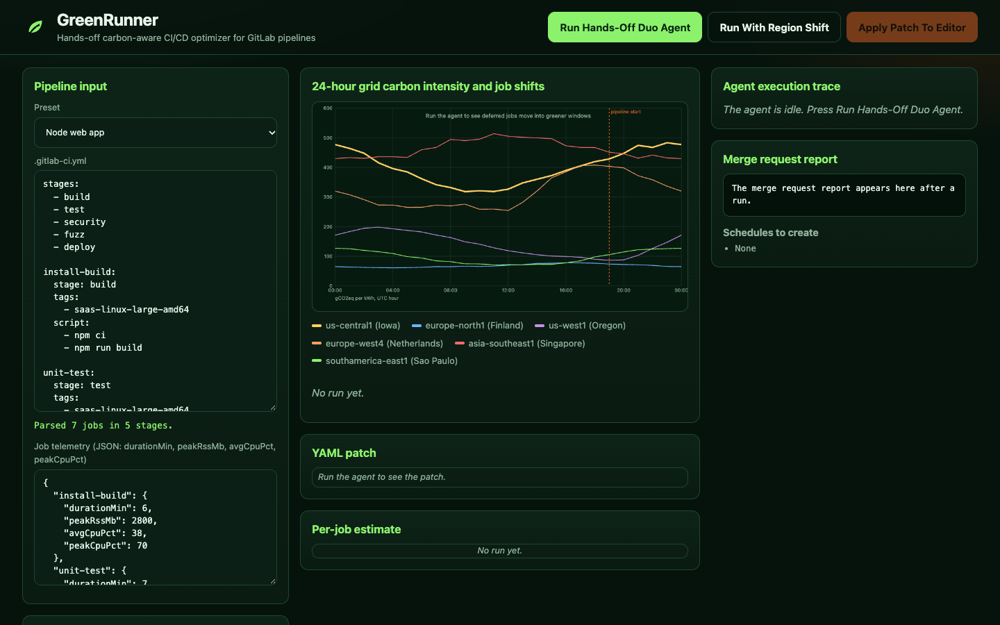

# GreenRunner

A hands-off, carbon-aware optimizer for GitLab CI/CD pipelines. Paste a `.gitlab-ci.yml`, add per-job telemetry, and an agent estimates the energy and carbon of one pipeline run, moves deferrable jobs into low-carbon windows (or regions), right-sizes over-provisioned runner tags, and writes the YAML patch plus a merge request report.

Live demo: https://aariv.me/green-runner/



This is a second entry for GitLab Transcend: Life After Code. It is aimed at Path A (a fresh hands-off agent for the stages after code is written) and the Most Environmentally Impactful category. That is the intent, not a claim about any outcome.

## What it does

1. Reads the pipeline with a small zero-dependency YAML reader (and writer) built for the `.gitlab-ci.yml` subset: maps, lists, lists of maps, inline lists, quoted strings, block scalars, comments.
2. Classifies jobs. Names or stages containing `fuzz`, `container_scanning`, `dast`, `benchmark` or `pages-nightly` are deferrable. Deploy and release jobs, and any job reachable from a pinned job through `needs` or `dependencies`, are pinned.
3. Simulates energy in watt-hours from runner size, duration, CPU and memory, then carbon in grams of CO2 equivalent from a 24-hour grid intensity curve for 6 regions.
4. Right-sizes runner tags such as `saas-linux-large-amd64` to `saas-linux-small-amd64` from peak CPU and memory telemetry, with 20% CPU and 30% memory headroom and a slowdown guard (`--max-slowdown` sets the limit).
5. Gives deferrable jobs a scheduled-pipeline `rules` gate for the greenest window within a delay limit, optionally in a lower-carbon region, and lists the pipeline schedules to create. Jobs tied together by `needs` share one window and keep their ordering; `needs` pointing outside the schedule and any `only`/`except` gates are removed, since GitLab does not allow them alongside `rules`.
6. Shows a side-by-side YAML patch, a per-job table, an agent trace, and a Markdown merge request report.
7. Runs a Carbon Pareto & Guardrail Lab on the page: a 5-policy x 6-preset comparator driven by real agent runs, six-region 24-hour intensity curves, a carbon-saved vs slowdown-budget Pareto frontier, a max-delay sweep, a greenest launch hour per region, SHA-256-audited brief exports (JSON, spreadsheet-safe CSV, Markdown), a `#gr=` shareable bookmark hash, and 22 in-page deterministic checks.

The same engine runs in the page and from the command line:

```
node cli.js examples/node-webapp.gitlab-ci.yml --telemetry examples/node-webapp.telemetry.json --region-shift --report green-report.md
```

## Judge shortcuts

"Run Hands-Off Duo Agent" runs time shifting and right-sizing. "Run With Region Shift" also lets jobs move to a lower-carbon region. "Apply Patch To Editor" writes the patch and the post-patch telemetry into the editors, and a second run then finds nothing further to change.

## Repository map

| Path | Purpose |
| --- | --- |
| `engine.js` | YAML reader and writer, energy and carbon model, agent, diff, report, six presets |
| `carbon-lab.js` | The lab: policy comparator, sweeps, SHA-256 brief exports, `#gr=` codec, in-page checks |
| `app.js`, `index.html`, `styles.css` | The page, with a canvas of the 24-hour curves and job moves |
| `cli.js` | Command line over the same engine |
| `.gitlab-ci.yml` | This project's own pipeline: tests, plus a merge request job that runs the agent and keeps its report as an artifact |
| `docs/agents.md` | How this is meant to run as a GitLab Duo agent, with what is and is not tested |
| `.gitlab/duo/agent-config.yml` | Execution settings for the agent, using the keys GitLab documents |
| `examples/` | A sample pipeline and telemetry file |

## Honest limits

- Every figure is an estimate from a stated model: 12 W per vCPU at full load, a 30% idle floor, 0.3 W per GB of memory in use and a PUE of 1.2. These coefficients are assumptions, not measurements of any real runner.
- The grid intensity curves are synthetic and illustrative. They are shaped like typical day and night patterns and are not real-time or historical data for any grid. Replace them with a real source before trusting the carbon numbers.
- Runner sizes (vCPU and memory per `saas-linux-*` tag) follow GitLab's hosted runner documentation as read on the build date.
- The agent logic runs locally in this page and in Node. It has not been executed on the GitLab Duo Agent Platform: no agent was registered, no flow ran and no merge request was opened by it. `docs/agents.md` is a plan, and it says why no flow definition file is included.
- Deferred jobs stop gating the pipeline. Region moves rely on self-managed runners tagged `green-<region>-<size>` and need a data residency check.
- The YAML reader covers the subset above. It rejects anchors, aliases and merge keys on purpose rather than guessing, so pipelines that use them need to be expanded first.

## Tests

```
npm test
```

This runs `node --test` with no installs: **423 tests, all passing** as of this revision. `tests/engine.test.js` (80 tests) covers the YAML reader and writer (including round trips of every preset and this repository's own pipeline), the energy model, right-sizing, window search, the agent's guardrails, the report and the command line. `tests/dom-smoke.test.js` (36 tests) checks the markup, drives the controller on a small fake DOM, and scans every file for dashes, emoji, uppercase kickers, credential-shaped strings and private details. `tests/carbon-lab.test.js` (303 tests) drives the whole lab: SHA-256 vectors, canonical JSON, CSV injection escaping, hostile `#gr=` hashes including `__proto__` keys, every one of the 30 policy-preset cells, sweep monotonicity, digest parity across the page line and all three exports, tamper detection, bookmark restore and controller delegation. `tests/batch6-hardening.test.mjs` (3 tests) covers hidden CSV formula prefixes, prototype-key digest copying and code-point-safe trace truncation.

## Verification & authorship

Verified locally on this revision: **423/423** `node --test` checks pass, the lab's **22/22** in-page deterministic checks pass, and a zero-dependency headless-Chromium audit (Node HTTP server + CDP, real pointer input) passes **69/69** checks at 1440x900 and 390x844 with 0 console errors, 0 page exceptions, 0 external requests and 0 horizontal overflow. The Hark honesty harness reports 0 violations and no em or en dashes exist in tracked files. The model, presets, telemetry values and documents are deterministically tested locally. Aariv Patel authored the project and owns the repository.

## License

MIT, see `LICENSE`.
